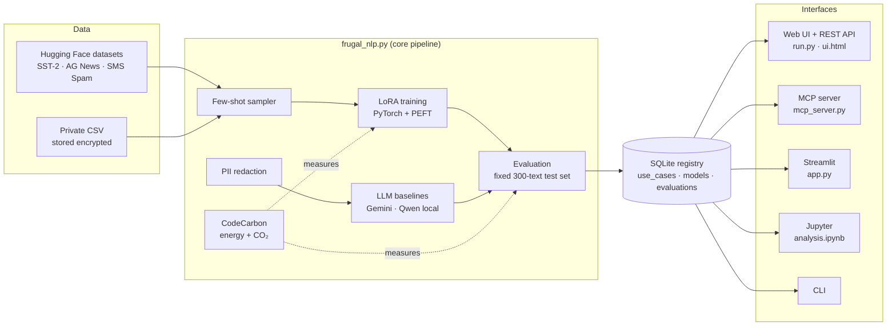
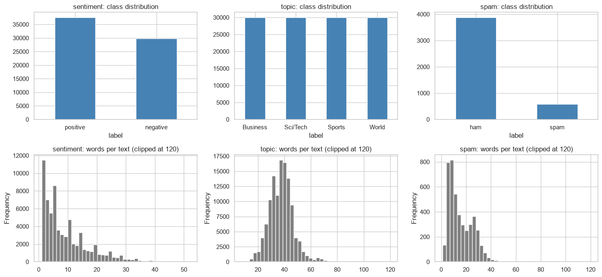
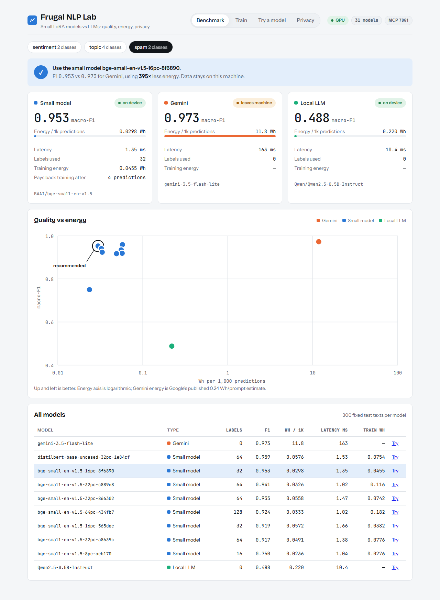
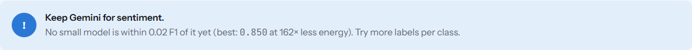
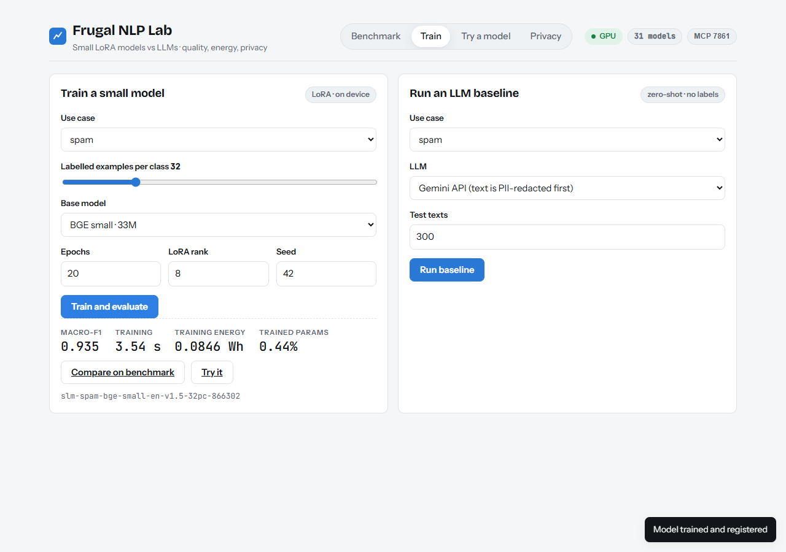
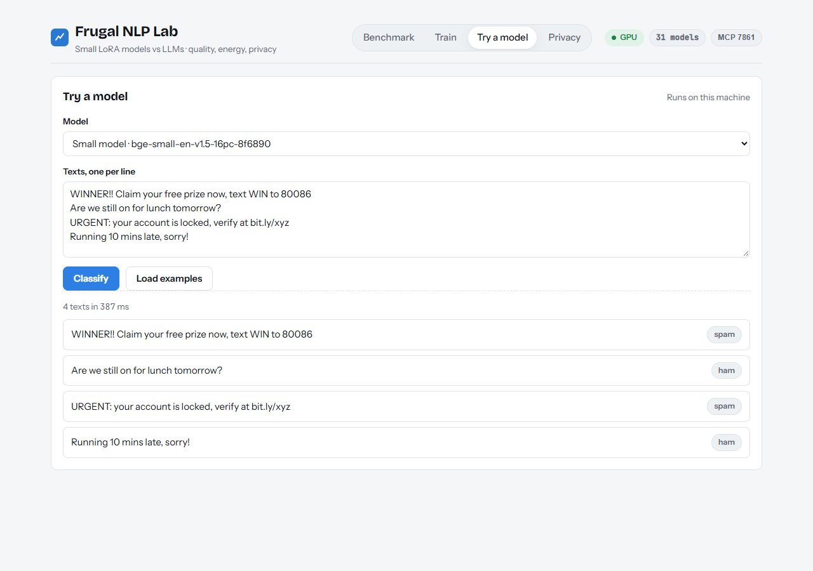
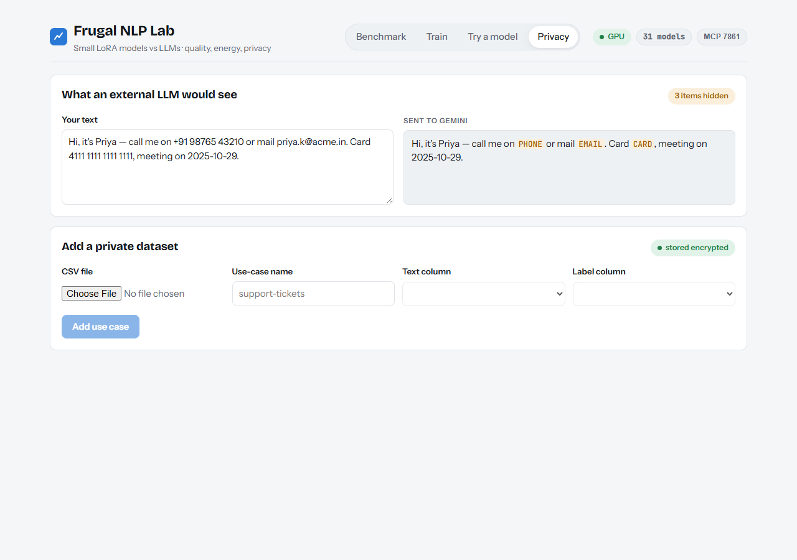
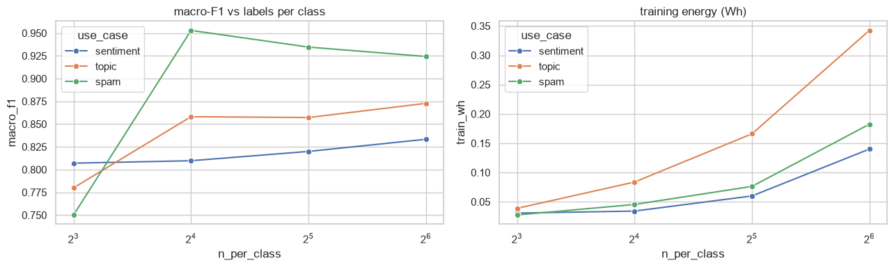

# Frugal NLP Benchmark: Project Guide

This guide covers the whole project: the problem, the approach, the architecture, every screen of the user interface, the supporting tools (REST API, MCP, Streamlit, Jupyter, CLI) and the results. You don't need a machine-learning background to follow it. Every technical term is defined in [Section 4](#4-key-concepts).

---

## Contents

1. [Summary](#1-summary)
2. [Problem statement](#2-problem-statement)
3. [Solution](#3-solution)
4. [Key concepts](#4-key-concepts)
5. [Architecture](#5-architecture)
6. [Datasets](#6-datasets)
7. [The web UI, screen by screen](#7-the-web-ui-screen-by-screen)
8. [Other interfaces](#8-other-interfaces)
9. [Experiment tracking: the model registry (and how it relates to MLflow)](#9-experiment-tracking-the-model-registry)
10. [Results](#10-results)
11. [Reproducibility and privacy guarantees](#11-reproducibility-and-privacy-guarantees)
12. [Limitations](#12-limitations)
13. [Repository layout](#13-repository-layout)
14. [Getting started](#14-getting-started)

---

## 1. Summary

**Frugal NLP Benchmark** answers one practical question:

> *For a given text-classification task, do we actually need a large language model, or is a small model trained on a handful of examples good enough?*

The project trains small models (33M–110M parameters) on **8 to 64 labelled examples per class** with LoRA. It then runs the same test as large language models (Gemini and a local Qwen model) and scores every model on three things:

| Dimension | How it is measured |
|---|---|
| **Quality** | Macro-F1 on a fixed set of 300 test texts |
| **Energy** | Watt-hours per 1,000 predictions, measured with CodeCarbon |
| **Privacy** | Whether any data left the machine, and how much personal data was redacted |

Every run is saved to a SQL model registry. A recommender then picks the cheapest model that is nearly as good as the best one.

**Main finding:** for spam detection the small model reaches **0.953 F1 vs Gemini's 0.973**, while using **about 395× less energy** per prediction. It is about 120× faster, and the data never leaves the machine. For news topics the recommended small model reaches 0.883 vs 0.894 with about 107× less energy. For movie-review sentiment, Gemini is still clearly better, and the system says so: it recommends keeping the LLM.

---

## 2. Problem statement

Large language models (LLMs) have become the default tool for every language task, including simple, high-volume ones such as *"is this message spam?"* or *"which department should handle this ticket?"*. That default has three hidden costs:

1. **Energy and cost.** Each prediction runs a model with billions of parameters in a remote data centre.
2. **Privacy.** Customer messages, emails and tickets are sent to a third-party provider.
3. **No evidence.** Teams rarely check whether a smaller model would be good enough. People assume fine-tuning needs thousands of labelled examples, and comparisons are seldom fair or repeatable.

**The questions this project answers:**

- With only a few labelled examples, how close can a small fine-tuned model get to an LLM?
- What does each option cost in energy?
- How can the choice be made systematic, repeatable and automatable?

---

## 3. Solution

The project is a small lab that runs the same procedure for any text-classification task (a **use case**):

| Step | What happens | Technology |
|---|---|---|
| 1. Sample | Draw *k* labelled examples per class (k = 8, 16, 32 or 64) | pandas, Hugging Face `datasets` |
| 2. Train | Fine-tune a small pre-trained model with LoRA, so only about 0.4–1 % of its weights are trained | PyTorch, `transformers`, `peft` |
| 3. Baseline | Ask the LLMs to classify the same texts with no training ("zero-shot") | Gemini API, local Qwen2.5-0.5B |
| 4. Evaluate | Score every model on the **same** 300 test texts | scikit-learn (macro-F1, accuracy) |
| 5. Measure | Record energy, CO₂ and latency around training and inference | CodeCarbon |
| 6. Record | Store the config, data hashes, metrics and environment for every run | SQLite registry |
| 7. Recommend | Among the models within 0.02 F1 of the best, pick the one with the lowest energy | SQL + Python |
| 8. Expose | Make all of this available to people and to AI agents | Web UI, REST API, MCP server, Streamlit, Jupyter |

---

## 4. Key concepts

| Term | Meaning |
|---|---|
| **Use case** | One classification job with a fixed set of labels, e.g. `spam` (ham / spam). Three are built in, and you can add your own from a CSV. |
| **LLM (Large Language Model)** | A very large general-purpose model, such as Gemini. It can classify text without training if you describe the task in a prompt. |
| **SLM (Small Language Model)** | A compact pre-trained model (here BGE-small, DistilBERT, DistilRoBERTa or BGE-base) that is fine-tuned for one task. |
| **Zero-shot** | Using a model on a task without showing it any labelled examples. This is how the LLM baselines run. |
| **Few-shot fine-tuning** | Training a model on a very small number of labelled examples (here 8–64 per class). |
| **LoRA (Low-Rank Adaptation)** | A fine-tuning method that freezes the original model and trains small add-on matrices. It makes training fast, cheap and small on disk. **LoRA rank** sets the size of those matrices. |
| **Epoch** | One full pass over the training examples. |
| **Seed** | A number that fixes all random choices, so a run can be repeated exactly. |
| **Macro-F1** | The main quality score, from 0 to 1. It averages the F1 score of each class equally, so a model can't score well by always predicting the majority class. This matters for spam, where only about 13 % of messages are spam. |
| **Wh / 1k** | Watt-hours of energy used to make 1,000 predictions. Lower is better. |
| **Latency** | Time per prediction in milliseconds. |
| **Train Wh** | Energy spent once to train the small model. |
| **Break-even** | The number of predictions after which the small model's total energy (training plus inference) drops below the LLM's. |
| **CodeCarbon** | An open-source library that measures the energy used by the CPU, GPU and RAM while code runs, and converts it to CO₂ using the local electricity grid's carbon intensity. |
| **PII (Personally Identifiable Information)** | Emails, phone numbers, card numbers, IP addresses and URLs. They are removed before any text is sent to an external API. |
| **Fernet encryption** | Symmetric encryption from the `cryptography` library. Uploaded private datasets are stored on disk only in encrypted form. |
| **Model registry** | A database of every model trained and every evaluation run. Here it is a SQLite file, `registry.db`. |
| **MCP (Model Context Protocol)** | An open standard that lets AI agents call external tools. The MCP server here gives an agent tools such as `create_model`, `test_model` and `recommend_model`. |
| **"on device" / "leaves machine"** | Badges in the UI showing whether a model runs locally or sends text to an external service. |

---

## 5. Architecture



- **`frugal_nlp.py`** holds all the logic: data loading, redaction, encryption, training, LLM calls, energy measurement, the registry and the recommender.
- **Every interface is a thin layer** over the same functions. The UI, MCP, Streamlit, notebook and CLI therefore always give the same results.
- **`run.py`** starts all services with one command.

---

## 6. Datasets

| Use case | Source | Classes | Why it is included |
|---|---|---|---|
| `sentiment` | SST-2 (Stanford movie reviews) | negative, positive | A hard case: sarcasm and negation |
| `topic` | AG News | World, Sports, Business, Sci/Tech | Multi-class news categorisation |
| `spam` | UCI SMS Spam Collection | ham, spam | A private-message scenario: about 8 % of messages contain PII |



*Figure 1: Class balance (top) and words per text (bottom). Spam is heavily imbalanced, which is why macro-F1 is used instead of accuracy. All texts are short, so a 128-token limit covers almost all of them.*

You can add your own use cases (for example, support tickets) by uploading a CSV. See [Privacy tab](#74-privacy-tab).

---

## 7. The web UI, screen by screen

Run `python run.py --open` and the UI opens at `http://127.0.0.1:7860/`.

### Header (present on every screen)

| Element | Meaning |
|---|---|
| **Benchmark · Train · Try a model · Privacy** | The four tabs, described below |
| **GPU / CPU** badge | The hardware the models run on. Hover to see the GPU name. |
| **31 models** | The number of models stored in the registry |

> The screenshots also show an **MCP 7861** badge. It came from an earlier version that served MCP over HTTP, and the current UI no longer shows it. MCP now runs over stdio only (see [Section 8.2](#82-mcp-server-for-ai-agents)).

---

### 7.1 Benchmark tab

The main dashboard. Pick a use case at the top to compare all models for it.



| Area | What it shows |
|---|---|
| **Use-case chips** (`sentiment`, `topic`, `spam`) | Pick which task to look at. The number shows how many classes the task has. |
| **Verdict banner** (blue, ✓) | The recommender's decision in one sentence, e.g. *"Use the small model … F1 0.953 vs 0.973 for Gemini, using 395× less energy. Data stays on this machine."* |
| **Three summary cards** | The best **Small model**, **Gemini** and **Local LLM** side by side: macro-F1, energy per 1k predictions (with a bar comparing them), latency, labels used, training energy, and *"Pays back training after N predictions"* (the break-even). |
| **"on device" / "leaves machine"** badges | Privacy at a glance. Only Gemini sends text off the machine, and that text is redacted first. |
| **Quality vs energy chart** | Each dot is one model. The vertical axis is F1 (higher is better). The horizontal axis is energy on a log scale (left is better). The best models sit **top-left**, and the circled dot is the recommended model. |
| **All models table** | Every evaluated model for this use case, sorted by F1. The recommended row is highlighted. **Try** opens that model in the *Try a model* tab. |

When no small model is close enough to the best LLM, the banner says so honestly:



*For sentiment, the best small model scores 0.850 vs Gemini's 0.972. That is outside the 0.02 tolerance, so the recommendation is to keep Gemini.*

---

### 7.2 Train tab

Here you create new models and LLM baselines.



**Left panel: Train a small model** (runs locally with LoRA)

| Field | Meaning | Default |
|---|---|---|
| Use case | The task to train for | — |
| Labelled examples per class | How many training examples per label (the "few" in few-shot) | 32 |
| Base model | The pre-trained small model to adapt: BGE small (33M), DistilBERT (66M), DistilRoBERTa (82M), BGE base (110M) | BGE small |
| Epochs | Training passes over the examples | 20 |
| LoRA rank | Size of the trainable adapter. Higher means more capacity and more parameters. | 8 |
| Seed | Fixes randomness so the run can be repeated exactly | 42 |
| **Train and evaluate** | Trains, tests on the 300 fixed texts, measures energy and saves everything to the registry | — |

After training, the panel shows **macro-F1**, **training time**, **training energy** and **trained params** (the share of weights LoRA actually updated, e.g. 0.44 %). It also shows the new **model ID**, with links to compare the model on the benchmark or try it.

> The model ID is readable and repeatable: `slm-spam-bge-small-en-v1.5-32pc-866302` means *small model · spam · BGE-small base · 32 examples per class · config hash*. The same settings always give the same ID.

**Right panel: Run an LLM baseline** (zero-shot, no labels)

| Field | Meaning |
|---|---|
| Use case | The task to test |
| LLM | **Gemini API** (text is PII-redacted before sending) or **local Qwen2.5-0.5B** (runs on your machine) |
| Test texts | How many test texts to score (default 300, the same set the small models use) |

---

### 7.3 Try a model tab

Classify your own text with any model in the registry.



| Element | Meaning |
|---|---|
| Model | Any registered small model or LLM baseline |
| Texts, one per line | The texts to classify |
| **Classify** | Runs the model and shows one label per line, plus the total time |
| **Load examples** | Fills in sample texts for the selected use case |

---

### 7.4 Privacy tab



**What an external LLM would see.** Type any text and see a live preview of exactly what would be sent to Gemini after redaction. Emails, phone numbers, card numbers (validated with the Luhn checksum), IP addresses and URLs are replaced with tags such as `EMAIL` or `PHONE`. Dates, years and amounts are deliberately left alone so they aren't mistaken for phone numbers. The badge counts how many items were hidden.

**Add a private dataset.** Upload a CSV, give the use case a name, and choose the text column and the label column. The file is stored **only in encrypted form** (`data/*.enc`), and the registry stores only hashes of the data, never raw text. The new use case then appears in every tab.

---

## 8. Other interfaces

`run.py` starts the web UI, the REST API and Jupyter, and prints their URLs:

```
  Web UI             http://127.0.0.1:7860/
  REST API           http://127.0.0.1:7860/api/status
  Jupyter notebook   http://127.0.0.1:7861/notebooks/analysis.ipynb?token=…
```

The MCP server and the Streamlit dashboard open no ports by default. You start them yourself when you need them (see below).

### 8.1 REST API

The web UI is built on a small JSON API, which other programs can also call:

| Endpoint | Purpose |
|---|---|
| `/api/status` | Device, GPU, running jobs, service URLs |
| `/api/overview` | Leaderboard, recommendation and break-even for a use case |
| `/api/train` | Train and evaluate a small model |
| `/api/llm` | Run an LLM baseline |
| `/api/predict` | Classify texts |
| `/api/redact` | PII redaction preview |
| `/api/register` | Add a private CSV use case |

### 8.2 MCP server (for AI agents)

MCP lets an AI agent use this pipeline as a set of tools. For example, an agent can be asked *"find me the cheapest model for spam that runs locally"*. It then calls the tools below on its own and returns an answer backed by the registry.

| Tool | What it does |
|---|---|
| `list_use_cases` | List available tasks |
| `register_use_case` | Add a private CSV task |
| `create_model` | Train a LoRA small model |
| `test_model` | Re-evaluate a model |
| `run_llm_baseline` | Run Gemini or the local LLM |
| `predict` | Classify texts |
| `list_models` | List registered models |
| `leaderboard` | Ranked results |
| `recommend_model` | Frugal recommendation, with energy / F1 / local-only constraints |
| `energy_breakeven` | Break-even analysis |
| `redact_pii` | Redact personal data |

The server also offers a **resource**, `registry://leaderboard`. It runs over stdio (`python mcp_server.py`), so it opens no network port, and `.mcp.json` registers it for MCP-compatible clients. Run `python mcp_server.py --demo` to see a scripted client use the tools end to end.

### 8.3 Streamlit dashboard (`app.py`)

An optional second UI with five tabs (**Leaderboard, Create model, LLM baseline, Predict, Privacy**). It covers the same features as the web UI in a simpler Python-only form. It is not started by `run.py`; launch it with `streamlit run app.py`.

### 8.4 Jupyter notebook (`analysis.ipynb`)

The analysis behind the results:

1. Exploratory data analysis (Figure 1)
2. **Learning curve:** how quality and training energy change with the number of labels
3. Reproducibility check: the same config gives the same model ID and the same score
4. Small models vs LLMs, read from the registry
5. Energy break-even
6. SQL queries on the registry



*Figure 2: Left: macro-F1 vs labelled examples per class (BGE-small). Spam reaches 0.95 with only 16 examples per class. Right: training energy grows with data but stays below 0.35 Wh, about the energy of one or two Gemini prompts (≈0.24 Wh each).*

### 8.5 Command line

```powershell
python frugal_nlp.py train --use-case topic --n-per-class 16
python frugal_nlp.py llm --use-case topic --provider gemini
python frugal_nlp.py predict --model-id <model_id> "Stocks rally as Fed holds rates"
python frugal_nlp.py recommend --use-case topic --local-only
python frugal_nlp.py benchmark --use-case all
python frugal_nlp.py leaderboard        # writes results/leaderboard.md
python frugal_nlp.py redact "mail me at a.b@corp.com"
```

---

## 9. Experiment tracking: the model registry

### Does this project use MLflow?

**No.** MLflow is a popular tool for tracking machine-learning experiments: it logs parameters, metrics and artifacts, and it keeps a model registry. This project does the same job with a **lightweight SQLite registry** (`registry.db`), so it needs no extra server and can be queried with plain SQL. The table below maps MLflow's ideas onto this project:

| MLflow concept | Equivalent in this project |
|---|---|
| Experiment | **Use case** (`use_cases` table) |
| Run | One training or evaluation (`models` + `evaluations` rows) |
| Parameters | `config` column (base model, k, epochs, LoRA rank, seed, …) |
| Metrics | `macro_f1`, `accuracy`, `wh_per_1k`, `latency_ms`, `co2_kg` |
| Artifacts | LoRA adapter folders in `models/` |
| Run ID | Model ID with config hash, e.g. `…-32pc-866302` |
| Model Registry / "best model" | `LEADERBOARD_SQL` ranking + `recommend()` |
| MLflow UI | Web UI **Benchmark** tab, Streamlit, notebook |

### Registry schema

| Table | One row per | Key columns |
|---|---|---|
| `use_cases` | custom task | name, labels, source, description |
| `models` | trained model or LLM baseline | model_id, base_model, n_train, trainable_params, config, config_hash, data_hash, train_kwh, train_co2_kg |
| `evaluations` | test run | model_id, test_hash, macro_f1, accuracy, wh_per_1k, latency_ms, energy_source, data_left_premises, pii_redacted |

The leaderboard is a single SQL query. It takes each model's latest evaluation and ranks models within each use case with `RANK() OVER (PARTITION BY use_case ORDER BY macro_f1 DESC)`. A snapshot is exported to [results/leaderboard.md](results/leaderboard.md).

### How the recommendation is made

1. Take all evaluated models for the use case, optionally filtered by maximum energy, minimum F1 or local-only.
2. Find the best macro-F1.
3. Keep the models within **0.02 F1** of that best.
4. From those, pick the one with the **lowest energy per 1,000 predictions**.

---

## 10. Results

Hardware: an NVIDIA RTX 3050 laptop GPU. Each model was tested on 300 fixed texts per use case.

| Use case | Recommended model | Its F1 | Gemini F1 | Model Wh / 1k | Gemini Wh / 1k | Energy saving | Latency (model vs Gemini) | Verdict |
|---|---|---|---|---|---|---|---|---|
| **Spam** | BGE-small, 16 / class | 0.953 | 0.973 | 0.030 | 11.8 | **~395×** | 1.4 ms vs 163 ms | Use small model |
| **Topic** | BGE-base, 32 / class | 0.883 | 0.894 | 0.107 | 11.5 | **~107×** | 3.1 ms vs 153 ms | Use small model |
| **Sentiment** | Gemini | 0.972 | 0.972 | 10.0 | 10.0 | — | — | Keep the LLM (best small model: 0.850) |

**Key takeaways**

- **Few labels go a long way.** Spam reaches 0.95 F1 with 32 labelled messages in total.
- **Training is almost free.** It takes 0.03–0.35 Wh and a few seconds per model, and pays for itself against Gemini within about 3–30 predictions.
- **A fine-tuned small model beats a prompted small LLM.** Zero-shot Qwen2.5-0.5B scores only 0.49 (spam) and 0.43 (topic) while using 4–12× more energy than the small models.
- **The benchmark is honest.** Where nuance matters (sentiment, with sarcasm and negation), the LLM keeps a clear lead, and the recommender reports it.
- **Privacy.** Small models keep all data on the machine. For the Gemini runs, the personal data in the spam test set was redacted before sending.

Full numbers are in [results/leaderboard.md](results/leaderboard.md) and the `results/benchmark_*.csv` files.

---

## 11. Reproducibility and privacy guarantees

**Reproducibility**
- Fixed seeds and deterministic GPU settings.
- The test set has its own seed (1234), so it is identical for every model, whatever the training seed.
- The model ID includes a hash of the training config. Each run stores SHA-256 hashes of the training and test data, plus library and GPU versions.
- Checked in the notebook: the same config gives a bit-identical F1.

**Energy measurement**
- CodeCarbon runs only around training and inference. Model loading is excluded.
- Gemini's server-side energy can't be measured from outside. It uses Google's published estimate of **0.24 Wh per prompt** (arXiv:2508.15734), labelled in the `energy_source` column so estimates are never mixed silently with measurements.

**Privacy**
- PII is redacted before any text reaches an external API.
- Uploaded datasets are stored only Fernet-encrypted.
- The registry stores hashes, never raw text.
- Every evaluation records `data_left_premises` and the number of redacted PII items.

---

## 12. Limitations

- Benchmarks cover three English datasets and short texts. Longer documents or other languages may behave differently.
- Gemini's energy is a published per-prompt estimate, not a direct measurement.
- Results come from a single consumer GPU. Absolute energy figures change with hardware and the local electricity grid (set with `CODECARBON_COUNTRY`).
- The 300-text test sample keeps runs fast and cheap. Larger test sets would narrow the confidence intervals.

---

## 13. Repository layout

| Path | Contents |
|---|---|
| `frugal_nlp.py` | Core pipeline and CLI |
| `run.py` | One-command launcher: web UI + REST API and Jupyter |
| `ui.html` | Web UI (Benchmark · Train · Try a model · Privacy) |
| `mcp_server.py` | MCP server (11 tools + 1 resource) and a demo client |
| `app.py` | Streamlit dashboard |
| `analysis.ipynb` | EDA, learning curves, reproducibility, SLM vs LLM analysis |
| `registry.db` | SQLite model registry, pre-filled with benchmark results |
| `models/` | Trained LoRA adapters, one folder per model ID |
| `data/` | Encrypted private datasets (`*.enc`) |
| `results/` | Leaderboard and per-use-case benchmark exports |
| `docs/` | Screenshots and figures used in this guide |
| `.env` | Configuration (Gemini key, country code, encryption key, device) |
| `.mcp.json` | MCP client registration |

---

## 14. Getting started

```powershell
# one-time setup (Windows)
py -3.11 -m venv .venv
.\.venv\Scripts\activate
pip install torch==2.6.0 --index-url https://download.pytorch.org/whl/cu124   # CPU only: pip install torch
pip install -r requirements.txt

# start everything
python run.py --open
```

The registry already holds the benchmark results, so the dashboard shows data straight away. The Gemini baseline is optional: set `GEMINI_API_KEY` in `.env` to enable it. Everything else works offline. See [README.md](README.md) for configuration and troubleshooting.
