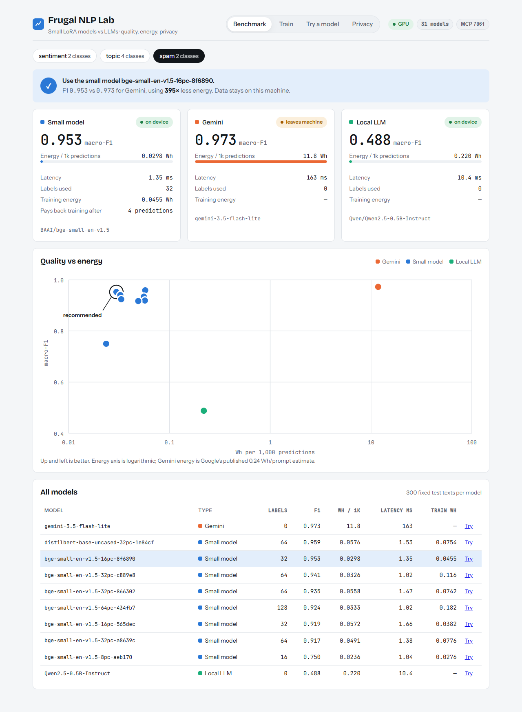

# Frugal NLP Benchmark with Small Models and MCP

Train a small text classifier from a handful of labelled examples and check whether you need a large language model at all. Every model is scored on quality, energy and privacy, and every run is saved to a SQL registry.

For the full explanation, see **[PROJECT_GUIDE.md](PROJECT_GUIDE.md)**.



## Setup

```powershell
py -3.11 -m venv .venv
.\.venv\Scripts\activate
pip install torch==2.6.0 --index-url https://download.pytorch.org/whl/cu124
pip install -r requirements.txt
```

If you have no NVIDIA GPU, install torch with `pip install torch` instead.

## Run

```powershell
python run.py --open
```

| Service | URL |
|---|---|
| Web UI | http://127.0.0.1:7860/ |
| REST API | http://127.0.0.1:7860/api/status |
| Jupyter notebook | printed in the terminal |

Press **Ctrl+C** to stop.

Other entry points:

| Command | What it does |
|---|---|
| `python mcp_server.py` | MCP server over stdio for AI agents (registered in `.mcp.json`) |
| `streamlit run app.py` | Optional Streamlit dashboard |
| `python frugal_nlp.py --help` | Command-line interface |

## Configuration (`.env`)

| Key | Purpose |
|---|---|
| `GEMINI_API_KEY` | Enables the Gemini baseline (optional) |
| `CODECARBON_COUNTRY` | Country code for carbon intensity, e.g. `IND` |
| `FRUGAL_DEVICE` | Set to `cpu` to force CPU |

## Files

| File | Contents |
|---|---|
| `frugal_nlp.py` | Core pipeline and CLI |
| `run.py` | Starts the web UI, REST API and Jupyter |
| `ui.html` | Web UI |
| `mcp_server.py` | MCP server |
| `app.py` | Streamlit dashboard |
| `analysis.ipynb` | Analysis notebook |
| `results/` | Leaderboard and benchmark results |
